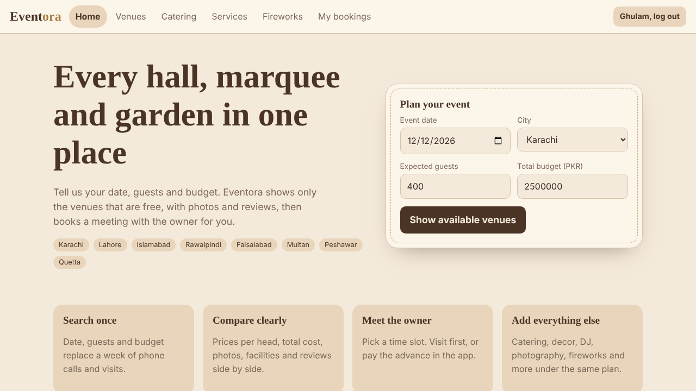
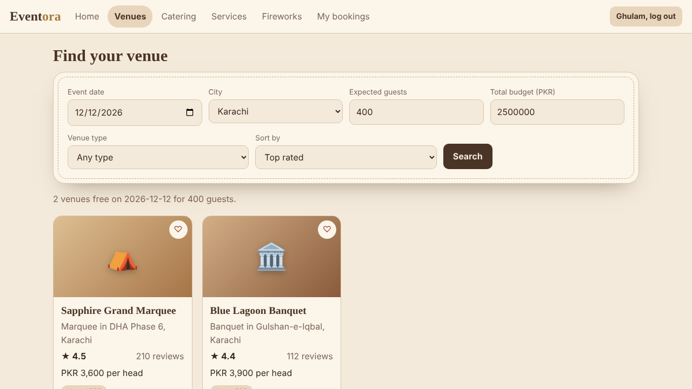
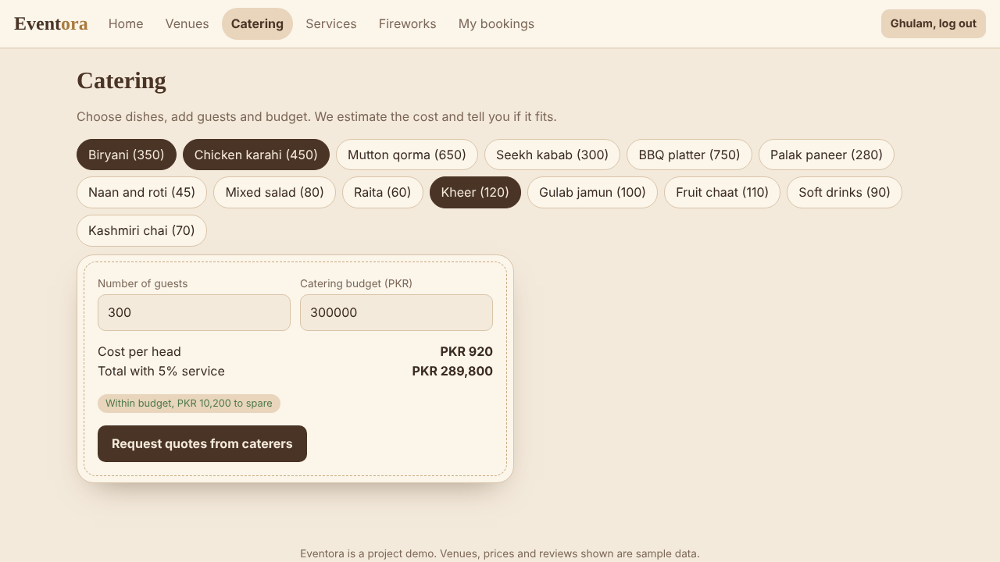
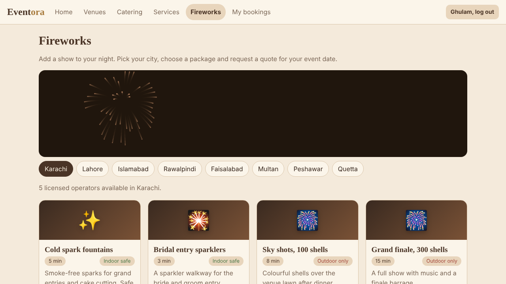

# Eventora

Eventora is a web app that helps people in Pakistan find and book event venues (halls, banquets, marquees, gardens and farmhouses) without visiting each one separately.

## Features
- Sign up and log in
- Search venues by date, city, expected guests, budget and venue type
- Only venues that are free on the chosen date are shown
- Venue details with gallery, facilities, price per head and reviews
- Book a meeting with the owner, or book the venue with a 25% advance
- Catering planner: pick dishes, guests and budget
- Event services: decoration, DJ and sound, photography, makeup, mehndi, lighting, transport, cards
- Fireworks packages by city
- Budget planner, saved venues and a My bookings dashboard
- Light and dark mode

## Screenshots
| Home | Venues |
|---|---|
|  |  |
|  |  |

## Run it
No install needed. Open `index.html` in any modern browser.

## Host it free with GitHub Pages
1. Go to the repository **Settings**, then **Pages**.
2. Under **Build and deployment**, choose **Deploy from a branch**.
3. Select the `main` branch and the `/ (root)` folder, then save.
4. After a minute the site is live at `https://<username>.github.io/<repository>/`.

## Tech
Single-file HTML, CSS and vanilla JavaScript. Data is stored in the browser (localStorage).

## Important notes
This is a front-end prototype. Venues, prices and reviews are sample data, and accounts and bookings are saved only in the visitor's own browser. Real payments, a database and a server are planned next steps.

## Roadmap
Online payments, venue owner dashboard, maps and directions, live chat, AI event planner, verified reviews, mobile apps.
